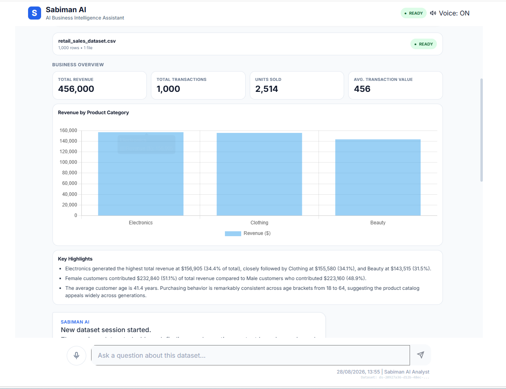
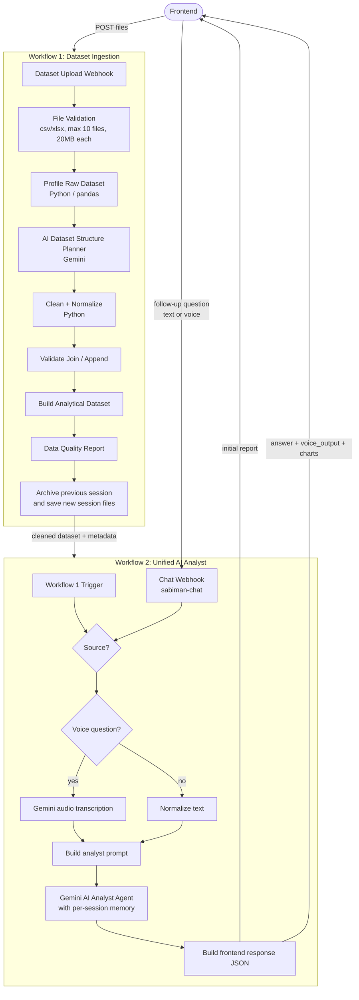
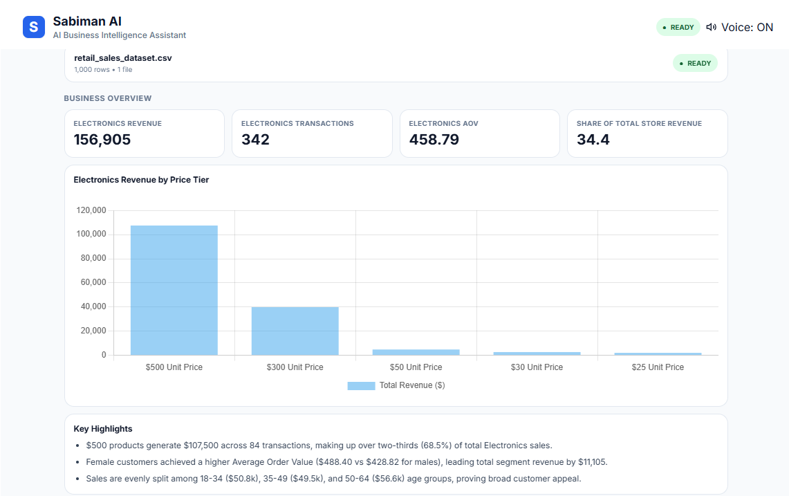
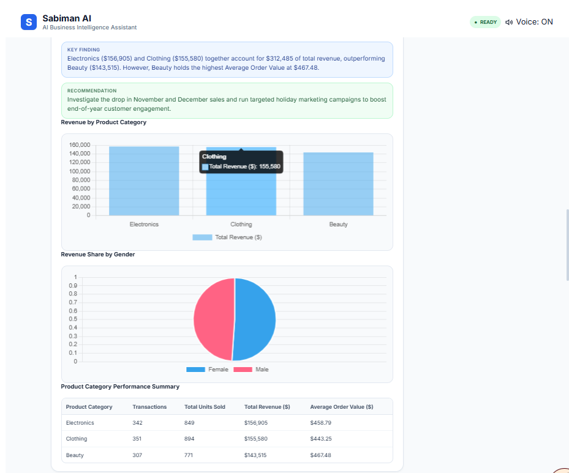

# SABIMAN AI: Conversational Sales Data Analyst

> Upload a sales spreadsheet. Get an instant executive report, KPIs and charts. Then just ask questions about your data by typing or speaking.

**Built with:** n8n · Google Gemini · Python (pandas) · Webhooks
**Type:** AI agent + data-cleaning pipeline (2 connected workflows)
**Status:** Live, in active development



### 🔗 Live demo
**[Open the SABIMAN AI frontend](https://link.msgsndr.com/preview/1wyBHWAKOV9UReJ1gRSS)**

> ⚠️ **Heads-up:** this project runs on a self-hosted n8n instance in Docker on my local machine, not on a cloud server. The backend is only online when I'm active, so the demo may be offline when you visit. **Want to try it with your own dataset? Message me and I'll bring it live for a walkthrough**, or import the workflows below into your own n8n to run it yourself.


---

## The problem

Small and mid-sized businesses sit on sales data in Excel and CSV files but can't afford a data analyst. Raw exports are messy (currency symbols in number columns, inconsistent casing, mixed date formats, duplicates), and even clean data takes time to turn into answers like *"What was our revenue last quarter?"* or *"Which product line is underperforming?"*

## The solution

SABIMAN AI handles the whole journey in two stages:

1. **Ingestion.** The user uploads one or more CSV/XLSX files from the frontend. The system profiles the data, uses AI to work out how the files relate (standalone, append, or join), cleans and normalizes everything, and produces a data-quality report.
2. **Analysis and conversation.** An AI analyst reads the cleaned dataset and returns an executive summary, key findings, KPIs, recommendations and chart-ready visualizations. After that, the user can ask follow-up questions in text or by voice, and the agent answers with a written reply, a speakable voice summary, and charts or tables when useful.

### What the user gets back

| Output | Description |
|---|---|
| Executive summary | Plain-English overview of the dataset |
| Key findings | Ranked by importance (high / medium / low) |
| KPIs | Headline numbers such as total sales and order counts |
| Visualizations | Bar, line, pie, doughnut, area, scatter and table specs for the frontend to render |
| Recommendations | Suggested actions based on the data |
| Voice output | A concise, speakable version of every answer |
| Quick questions | Suggested follow-ups to keep the conversation going |
| Data-quality report | What was cleaned, converted, removed or flagged |

---

## Architecture



### Workflow 1: Dataset Ingestion
`workflows/01-dataset-ingestion.json` (20 nodes)

| Stage | What happens |
|---|---|
| Validate | Rejects missing session IDs, unsupported file types, too many files, or files over the size limit |
| Profile | pandas computes column names, types, null rates, sample values and duplicate counts per file |
| Plan (AI) | Gemini decides whether files should be **standalone / append / join / reject** and classifies every column (date, currency, percent, number, boolean, category, identifier, text). It is told to be conservative: never invent a join key, and fall back to `text` when unsure |
| Clean | Strips currency and percent symbols, normalizes categories, maps booleans, trims whitespace, drops fully empty columns, and flags constant columns |
| Validate the plan | Safety checks before merging, such as refusing to append files that share under 60% of their columns |
| Build | Executes the ordered append/join operations to produce a single analytical dataset |
| Report | Counts missing values, duplicates, conversions and invalid values, and carries warnings forward |
| Persist | Archives the previous session and writes the new dataset and metadata atomically (temp file, then rename) |
| Hand off | Calls Workflow 2 and returns the initial analysis to the frontend |

### Workflow 2: Unified AI Analyst
`workflows/02-unified-ai-analyst.json` (17 nodes)

One workflow with two entry points:

- **Initial analysis:** called by Workflow 1 with the cleaned dataset. The dataset, column roles and quality report are loaded into the agent's session memory, and the first report is generated.
- **Follow-up questions:** called directly from the frontend (`/sabiman-chat`). Text questions go straight to the agent. Voice questions are transcribed with Gemini first. The agent answers from its remembered dataset, so the data is never re-sent.

Each dataset gets its own memory session (`dataset_session_id`), so uploading a new dataset starts a clean conversation.

The agent is instructed to never invent numbers, to state clearly when information is missing, and to return strict JSON so the frontend can render every response the same way.

---

## Tech stack

| Layer | Tool |
|---|---|
| Orchestration | n8n (webhooks, sub-workflow execution, code nodes) |
| LLM | Google Gemini (planning, analysis, audio transcription) |
| Data processing | Python + pandas + openpyxl |
| Agent memory | n8n Window Buffer Memory (keyed per dataset session) |
| Interface | Custom frontend, which calls the two webhooks |
| Hosting | Self-hosted n8n in Docker (local machine); cloud deployment planned |

## API contract

**Upload:** `POST /webhook/sabiman-dataset-upload` (multipart)
- `dataset_session_id`: required
- one or more `.csv` / `.xlsx` files

**Ask a question:** `POST /webhook/sabiman-chat`
- Text: `{ "type": "text", "session_id": "...", "question": "What was total revenue in 2018?" }`
- Voice: `type: "voice"` with the recorded audio attached as binary field `audio`

**Response shape (both):**
```json
{
  "success": true,
  "answer": "...",
  "summary": "...",
  "voice_output": "...",
  "findings": [{ "title": "", "detail": "", "importance": "high" }],
  "kpis": [{ "label": "", "value": 0, "formatted": "" }],
  "visualizations": [{ "type": "bar", "title": "", "labels": [], "datasets": [] }],
  "recommendations": [],
  "quick_questions": []
}
```

---

## See it in action

**1. Upload a file, get an instant business overview.** KPIs, a chart and plain-English highlights are generated automatically, with voice mode available.


**2. Ask a follow-up and get a focused deep-dive.** Here the analyst breaks Electronics down by price tier, with its own KPIs, chart and highlights.



**3. Findings, recommendations, charts and tables in one response.** The agent flags key findings, suggests actions, and returns pie charts and summary tables.



### Example questions

- "What was our total revenue?"
- "Break down Electronics revenue by price tier."
- "How does spending compare between male and female customers?"
- "What happened to sales in November and December?"

*Screenshots use a sample retail sales dataset (1,000 rows).*

---

## Current limitations and roadmap

Being upfront about where the project is today:

- **Single-sheet Excel files only.** For `.xlsx` uploads, only the first sheet is read. Workbooks with multiple sheets or tables inside one file are not yet handled. *Next step: read every sheet and feed them through the existing standalone/append/join planner.*
- **Multi-tenant support is in progress.** Tenant resolution is currently a placeholder; real per-business authentication is planned.
- **Not yet deployed to a cloud server.** The system currently runs locally in Docker, so the live demo is available on request. *Next step: move n8n to a VPS so the demo is always online.*
- **Session storage is temporary by default.** Session files are written under `/tmp` unless a persistent directory is configured.

## Setup (to run the workflows yourself)

1. Import both JSON files from `workflows/` into n8n.
2. Add a **Google Gemini (PaLM) API** credential and attach it to the Gemini nodes in both workflows. Credentials are intentionally not included in the exports.
3. In Workflow 1, open **Execute Workflow — Dataset Analysis (Initial EDA)** and point it at your imported copy of Workflow 2.
4. Make sure the n8n Python (native) task runner has `pandas` and `openpyxl` available.
5. Activate both workflows and call the two webhooks from your frontend.

---

## License and security

- **License:** © 2026 [Your Full Name]. All rights reserved. You may view the project and import the workflows for personal evaluation and testing. Commercial use or redistribution requires written permission. See [LICENSE](./LICENSE).
- **Security:** credentials and sample data have been removed from the exports. Always use your own API keys. See [SECURITY.md](./SECURITY.md) to report an issue.

---

*Built by [Your Full Name]. Want something like this for your business? Message me on [LinkedIn / Upwork / email].*
